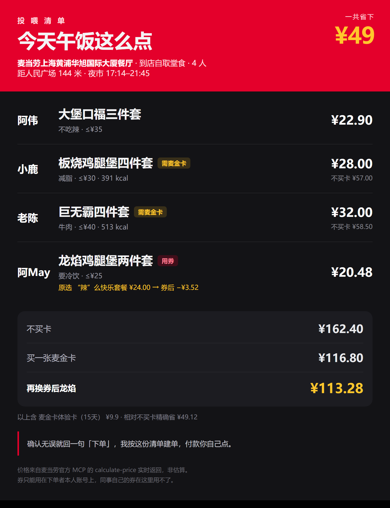

# 投喂官 · team-feed

> 帮「被派去买全组午饭的那个人」，在 30 秒内完成一次不会有人不满意的点单。

麦当劳 1024 程序员创意开发大赛参赛作品。基于麦当劳官方 MCP 构建的 Agent Skill。


---

## 它解决什么

被同事派去买饭的时候，难的从来不是「我想吃什么」，是这三件事：

1. **冲突** —— A 不吃辣、B 在减脂、C 只要牛肉、D 预算 25。人肉算不动。
2. **钱** —— 券绑在**你一个人的账号**上，用在哪道菜上最省，是个分配问题。
3. **交付** —— 点完要能直接发群里确认，不能只说一句「点好了」。

`team-feed` 把这三件事用真实菜单、真实营养数据、真实算价一次做完。

## 真实跑出来的效果

2026-10-23 17:40，上海华旭国际大厦店，4 人晚餐：

| 谁 | 点什么 | 约束 | 原价 | 实付 |
|---|---|---|---|---|
| 阿伟 | 大堡口福三件套 | 不吃辣 · ≤¥35 | ¥22.9 | ¥22.9 |
| 小鹿 | 板烧鸡腿堡四件套 | 391 kcal · ≤¥30 | ¥57.0 | ¥28.0 |
| 老陈 | 巨无霸四件套 | 纯牛肉 · ≤¥40 | ¥58.5 | ¥32.0 |
| 阿May | 龙焰鸡腿堡两件套 | ≤¥25 · 用 1024 券 | ¥34.0 | ¥20.48 |

加一张麦金卡体验卡 ¥9.9。**原价 ¥182.30 → 实付 ¥113.28，省 ¥69.02**（相对「不买卡」方案是省 ¥49.12）。

不是估算，全部来自 `calculate-price` 的实际返回。文字版见 [`examples/demo-card.md`](examples/demo-card.md)。



上面这张卡片由 `scripts/render_card.py` 从求解结果直接渲染，**渲染层不生成任何数字**，只负责排版。

## 三个只有真跑过才知道的坑

这三个坑会让人交出一份**数字全错**的作品，所以单独列出来。

### 1. 菜单上的价，不是结算价

`query-meals` 里板烧鸡腿堡四件套显示 **¥28**，`discountType` 是 `随单购麦金卡优惠`。
不加 `withOrder` 直接算价 → **¥57**。翻倍。

真实成本是两档：买卡 ¥28+9.9=**¥37.9**，不买卡 **¥57**。优化器拿 ¥28 去比，结论必然错。

### 2. 券专属商品不在菜单里，不带券会被静默丢弃

「龙焰鸡腿堡两件套」(9900016523) 在 122 项菜单里查不到，只有带 `couponId` 才算得出价。
反过来，**不带券的券专属商品不会报错，直接从 `productList` 里消失**，总价看起来还"正常"。

所以算完价必须核对 `productList` 的商品数。

### 3. 营养数据不全，覆盖率 42/122

`list-nutrition-foods` 返回的是一张**定宽字符串表格**（不是 JSON）：160 行数据、158 个唯一菜名（有 2 个重名会互相覆盖）。它**以单品为主，少数套餐自带条目**（板烧鸡腿堡四件套的 391 kcal 就来自这里），但覆盖不全——122 项菜单里能对上 43 个条目，扣掉 1 个 0 kcal 的「纯悦」水，**真正有热量的只有 42 项**。
套餐热量要先用 `query-meal-detail` 按 `rounds[].choices[]` 拆出子项，再逐个匹配累加。

---

## 怎么用

### 1. 拿 MCP Token

`open.mcd.cn/mcp` → 右上角登录（麦当劳会员账号）→ 控制台 → 激活 → 复制。

### 2. 接入

```json
{
  "mcpServers": {
    "mcd-mcp": {
      "type": "streamablehttp",
      "url": "https://mcp.mcd.cn",
      "headers": { "Authorization": "Bearer YOUR_MCP_TOKEN" }
    }
  }
}
```

### 3. 装 Skill

把本仓库的 `SKILL.md` 放进你的 Skills 目录，然后说：

> 我们组 4 个人要吃饭，我在上海人民广场，帮我们点。

### 4. 本地跑一遍参考实现

```bash
pip install pillow          # 只有渲染卡片需要，求解本身零依赖

python scripts/team_feed.py --demo
# 叠加券替换建议（券后价需实测填入，见下）
python scripts/team_feed.py --demo --coupons scripts/coupons.demo.json
# 输出结构化结果，供渲染卡片使用
python scripts/team_feed.py --demo --coupons scripts/coupons.demo.json --json out.json
# 渲染成可发群的图片卡片（需要本机 Chrome）
python scripts/render_card.py out.json card.png
```

`menu.json` 是 2026-10-23 的真实快照，**离线可跑**。脚本只做两件不需要联网的事：约束求解、买卡/不买卡的账。**券后价必须由 `calculate-price` 实测**，所以 `--coupons` 读的是你手工填好 `coupon_price` 的 json，缺这个字段的券会被直接跳过（不猜）。

渲染层**不生成任何业务数字**：图片上每个价格都来自 `out.json`，也就是 `calculate-price` 的返回值。改样式不会改到钱。

## 仓库结构

```
SKILL.md                          Skill 主体：六步流程 + 约束 + 安全边界
references/tool-contract.md       35 个工具的实测契约（参数名、返回形态、坑）
scripts/team_feed.py              约束求解 + 买卡双账 + 券替换建议
scripts/parse_mcp.py              MCP 混合文本 → 结构化数据
scripts/render_card.py            结构化结果 → 图片卡片（Chrome 无头截图）
scripts/menu.json                 真实菜单快照（122 项）
scripts/coupons.demo.json         券清单样例（含 coupon_price 的写法）
examples/demo.gif                 终端运行实录（真实 stdout）
examples/demo-card.png            真实输出的图片卡片
examples/demo-card.md             同一份清单的文字版
MCP_INTEGRATION.md                MCP 集成说明：Server / 35 个 Tool / 调用流程 / 业务价值
workbuddy.md                      WorkBuddy 开发对话记录
CONTEST_DECLARATION.md            参赛声明（官方原文，未作任何改动）
mcp-config.example.json           MCP 配置示例（Token 仅用环境变量占位符）
LICENSE                           MIT
```

## 安全边界

- 全流程**只读**，`create-order` 绝不自作主张调用。
- 下单前必须：念完清单 → 用户明确说"下单" → 才建单。
- 付款永远由人完成，Agent 只建单。
- 不脑补用户的忌口。「不吃辣」不代表不吃香菜。

## 已完成 / 未完成

**已完成**：门店定位、菜单拉取、营养解析、约束求解、买卡双账对比、券替换建议、真实算价、**图片卡片渲染**。4 人篮子的三档账与 `calculate-price` 逐项对得过：

| 方案 | 实付 |
|---|---|
| 不买卡 | ¥162.40 |
| 买卡 | ¥116.80 |
| 换券后龙焰 | ¥113.28 |

**未完成**：团餐 `beType=6` 场景（`query-meal-assistance` 接口确认可用但未做流程）、多人多轮改单、券后价自动获取（现需手工填 `coupon_price`）、外送/得来速的取餐码流程。

## 自查记录

发布前对全仓库做了一遍「照着做能不能跑通」的复核，修掉的问题：

| 问题 | 影响 |
|---|---|
| `extract_json` 只认 `## Original Response` | 券接口没有这个标记，**券解析恒为 None**，券分配根本走不到 |
| `flatten_menu` 没带出 `discountType` | 用解析库重新生成菜单就丢 `needs_card`，双账对比失效，退化成「拿 ¥28 比价」 |
| 旧版 `assign_coupons` 从券标题抠价格 | 券标题不含价格，必崩；已改为只接受实测 `coupon_price` |
| `menu.json` 用相对路径 | 从仓库根目录跑直接 `FileNotFoundError` |
| SKILL 里写了 `searchType=3` + 经纬度 | 线上 `inputSchema` 没有这两个参数，照着调会失败 |
| 「要冷饮」当硬约束 | tags 覆盖率太低，会筛到零候选 |
| 两个章节都叫 Step 5 | 流程编号断裂 |
| demo-card 里「不买卡 ¥182.30」 | 实测应为 ¥158.88，已修正 |

---

MIT License · 数据来自麦当劳中国官方 MCP
